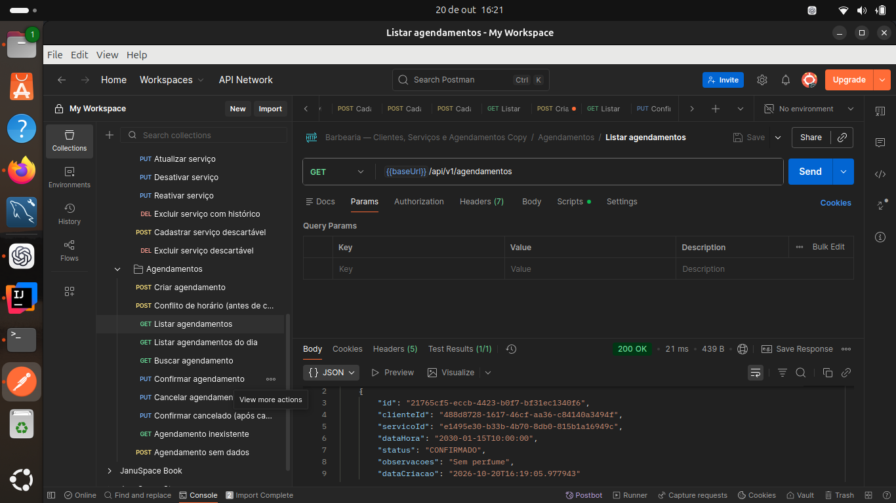
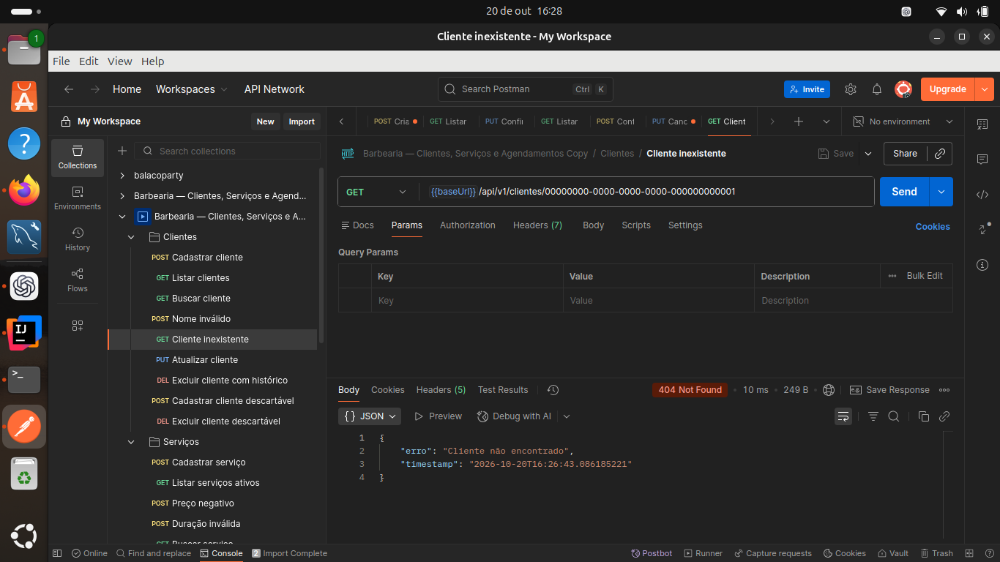

# API de agendamentos para barbearia

Projeto de estudo com Java 17, Spring Boot 3.5.13, Maven e PostgreSQL.

A API cadastra clientes e serviços e permite criar, consultar, confirmar e cancelar agendamentos. Não tem frontend: use o Postman.

## Como abrir e rodar

1. Abra esta pasta no IntelliJ como projeto Maven e selecione Java 17.
2. Em um PostgreSQL disponível, crie o banco:

```sql
CREATE DATABASE barbearia;
```

3. Configure as variáveis `DB_URL`, `DB_USER` e `DB_PASSWORD` na execução de `BarbeariaApiApplication`. Exemplo de URL: `jdbc:postgresql://localhost:5432/barbearia`.
4. Execute `BarbeariaApiApplication`. A API estará em `http://localhost:8080`.

Também pode usar o terminal desta pasta:

```bash
export DB_URL=jdbc:postgresql://localhost:5432/barbearia
export DB_USER=postgres
read -s -p 'Senha do PostgreSQL: ' DB_PASSWORD
export DB_PASSWORD
mvn spring-boot:run
```

O Hibernate cria/atualiza as tabelas, sem apagar os registros ao encerrar. Em seguida, `schema.sql` adiciona a regra que impede horários sobrepostos. O usuário do banco precisa ser dono das tabelas para criá-las e alterá-las.

## Organização do projeto

Os controllers usam `@Autowired` e `@ResponseStatus`; os serviços usam nomes como `CadastroClienteService`, `salvar` e `buscarOuFalhar`.

```text
src/main/java/com/barbearia/
├── api/
│   ├── controller/        Endpoints HTTP
│   ├── model/             Objetos de resposta: ClienteModel, ServicoModel...
│   │   └── input/         Dados recebidos: ClienteInput, ServicoInput...
│   ├── assembler/         Conversão entre input, entidade e model
│   └── exceptionhandler/  Respostas de erro em JSON
├── domain/
│   ├── model/             Entidades persistidas
│   ├── repository/        Acesso ao banco
│   ├── service/           Cadastro e fluxo dos agendamentos
│   └── exception/         Erros de negócio
└── BarbeariaApiApplication.java
```

O Lombok gera getters, setters e construtores. Após abrir o projeto no IntelliJ, recarregue o Maven para reconhecer a dependência adicionada. As conversões nos assemblers foram escritas com getters e setters para que cada campo fique visível no código.

O projeto utiliza Java 17, Spring Boot 3, UUID e PostgreSQL.

## Endpoints

Todos começam com `/api/v1`.

| Método | Caminho | Resultado |
| --- | --- | --- |
| POST | /clientes | Cadastra (201) |
| GET | /clientes | Lista (200) |
| GET | /clientes/{id} | Busca (200) |
| PUT | /clientes/{id} | Edita (200) |
| DELETE | /clientes/{id} | Exclui quando não há agendamentos (204) |
| POST | /servicos | Cadastra ativo (201) |
| GET | /servicos | Lista os ativos (200) |
| GET | /servicos/{id} | Busca, inclusive inativos (200) |
| PUT | /servicos/{id} | Edita, ativa ou desativa (200) |
| DELETE | /servicos/{id} | Exclui quando não há agendamentos (204) |
| POST | /agendamentos | Cria uma reserva (201) |
| GET | /agendamentos | Lista; aceita `?data=2030-01-15` (200) |
| GET | /agendamentos/{id} | Busca (200) |
| PUT | /agendamentos/{id}/confirmar | Confirma (200) |
| PUT | /agendamentos/{id}/cancelar | Cancela (200) |

São os 10 endpoints detalhados no desafio, mais 5 para completar o CRUD de clientes e serviços.

## Testar no Postman

Importe `postman/Barbearia.postman_collection.json`.

1. Execute **Cadastrar cliente** e **Cadastrar serviço**. Os IDs são salvos nas variáveis da coleção.
2. Execute **Criar agendamento**. Seu ID também será salvo.
3. Teste consulta, filtro por dia, confirmação e cancelamento.
4. Use os pedidos de erro para testar dados inválidos, conflito e exclusão impedida.

Se repetir o cadastro de um telefone existente, a API retorna 400. Nesse caso, use o ID da listagem na variável `clienteId`. Para alterar o dia da reserva, ajuste `dataHoraAgendamento` e `dataAgendamento` na coleção.

Exemplo de cliente:

```json
{
  "nome": "João Silva",
  "telefone": "11987654321",
  "email": "joao@email.com"
}
```

Exemplo de serviço:

```json
{
  "nome": "Corte Simples",
  "preco": 50.00,
  "duracao": 30
}
```

Para editar um serviço, envie esses três campos e também `"ativo": true` ou `"ativo": false`. Para editar cliente, use os campos do cadastro; omitir email remove o email existente.

Exemplo de agendamento:

```json
{
  "clienteId": "UUID retornado no cadastro",
  "servicoId": "UUID retornado no cadastro",
  "dataHora": "2030-01-15T10:00:00",
  "observacoes": "Sem perfume"
}
```

## Regras adotadas

- O telefone é obrigatório e único; email é opcional.
- Serviços exigem nome, preço não negativo com até duas casas decimais e duração positiva em minutos. Preço zero é permitido.
- Existe uma agenda única: um atendimento de cada vez. O desafio não define vários barbeiros.
- A reserva ocupa toda a duração: 10:00–10:30 impede uma reserva às 10:15, mas permite outra às 10:30.
- O serviço deve estar ativo. Sua duração é registrada na reserva; edições futuras não mudam reservas existentes.
- Cancelar libera o horário. Cancelar de novo ou confirmar um confirmado mantém o estado e retorna 200. Um cancelado não pode ser confirmado; crie outra reserva.
- A chave estrangeira impede a exclusão de clientes/serviços com qualquer agendamento, inclusive cancelado; o serviço converte essa rejeição em 409 para preservar o histórico. Um serviço pode ser desativado.
- As listas de agendamentos incluem cancelados e são ordenadas pelo início. O filtro considera a data de início.
- Datas são locais à barbearia e têm precisão de segundos; frações são descartadas. O enunciado não define expediente nem proíbe datas passadas, então essas regras não foram adicionadas.
- Dados inválidos retornam 400; registro procurado inexistente, 404; conflitos, 409. Cliente/serviço inexistente ao criar uma reserva retorna 400, seguindo o exemplo do desafio.

### Por que há um arquivo SQL?

A consulta no Java detecta um horário ocupado, mas duas requisições podem consultar ao mesmo tempo e encontrar o horário livre. A restrição `horario_sem_sobreposicao` do PostgreSQL impede que ambas sejam salvas. O tratamento de erros transforma essa rejeição em 409.

A regra usa intervalos de tempo e ignora cancelados. Essa é a parte específica do banco, isolada em `src/main/resources/schema.sql`. Referência: [restrições de intervalos no PostgreSQL](https://www.postgresql.org/docs/16/rangetypes.html#RANGETYPES-CONSTRAINT).

Não existe mais tabela de controle da agenda no código. Caso você tenha rodado a versão antiga, sua tabela `agenda` pode continuar no banco; ela não é usada e não precisa ser apagada.

## Testes automatizados

Os testes usam **PostgreSQL**, o banco de dados utilizado pelo projeto.

Crie um banco exclusivo:

```sql
CREATE DATABASE barbearia_test;
```

Configure as credenciais desse banco e execute:

```bash
export TEST_DB_URL=jdbc:postgresql://localhost:5432/barbearia_test
export TEST_DB_USER=postgres
read -s -p 'Senha do banco de testes: ' TEST_DB_PASSWORD
export TEST_DB_PASSWORD
mvn test
```

**Nunca aponte os testes para um banco com seus dados: o perfil de testes recria e apaga as tabelas.**

Os testes verificam CRUD, validações, status HTTP, conflitos, cancelamento, proteção do histórico e concorrência. Consulte `VALIDACAO.md` para os resultados da versão atual.

Para gerar o executável: `mvn package` (também executa os testes). Depois, com as variáveis `DB_*` configuradas, execute `java -jar target/barbearia-api-0.0.1-SNAPSHOT.jar`.

## Entrega do desafio

A coleção do Postman, o README e os prints de sucesso e erro estão incluídos no projeto. Para entregar, publique o projeto no GitHub e compartilhe o link. Autenticação, relatórios, paginação e deploy são extras e não foram implementados.

### Evidências no Postman

Listagem de agendamentos com resposta **200 OK** e agendamento confirmado:



Busca de cliente inexistente com resposta **404 Not Found** e mensagem de erro em JSON:


